# Product growth and experimentation analytics

I built this project to practise the full set of things a product or growth analyst
does: model raw event data in SQL, define metrics, find where users drop off, run and
read A/B tests properly, predict churn, and judge which marketing channels pay for
themselves.

The company is made up. Kinora is a freemium fitness-coaching app with a 7-day trial and
monthly or annual plans. Real product event logs and A/B test results are not public, so
I wrote a simulator that generates 13 months of data (149k users, 5.8M events,
subscriptions, payments and marketing spend). Because I planted the effects myself, I
could check whether my analysis recovers them. The findings describe the simulator, not
a real business.

## Questions

1. How engaged are users, and which acquisition channels bring users who stay?
2. Where does the signup-to-paid funnel leak, and is there an early "aha moment"?
3. Should we ship the new onboarding flow? (A/B test on new users)
4. Do smart workout reminders increase workouts, and does the effect last? (A/B test on existing users)
5. Can we predict which subscribers will cancel, and is it worth acting on?
6. Which marketing channels are worth the money, and how should the budget move?

## Main results

| Area | Result |
|---|---|
| Engagement | D7 retention 35.1%, D30 14.6%. Stickiness (DAU/MAU) rose from 9.9% to 15.6% over the year. |
| Channels | D30 retention ranges from 22.0% (referral) to 9.8% (influencer). |
| Funnel | Only 19% of users who see the paywall start a trial. 60% of trials convert. |
| Activation | Users active on 3+ of their first 7 days: D30 retention 32.6% vs 4.2% for everyone else. |
| Onboarding test | Caught a sample ratio mismatch on web (p < 1e-30). On iOS and Android, D7 retention +3.3 pp (37.2% to 40.5%, CI +1.6 to +5.0). Simulated truth: +3.6 pp. |
| Reminders test | Raw lift +1.11 workouts was inflated by a pre-existing imbalance. CUPED: +0.59 (CI +0.21 to +0.98), truth +0.61. Variance down 56%. Effect fades from week 1 to week 4. |
| Churn model | Logistic regression, test ROC-AUC 0.72. Targeted retention offer: $1,265 per 1,000 subscribers vs $512 for a blanket discount. |
| Marketing | LTV:CAC is 2.24 for search, 1.27 for paid social and 0.64 for influencer. Same budget, re-allocated: +11% paying subscribers. |

## Engagement and retention

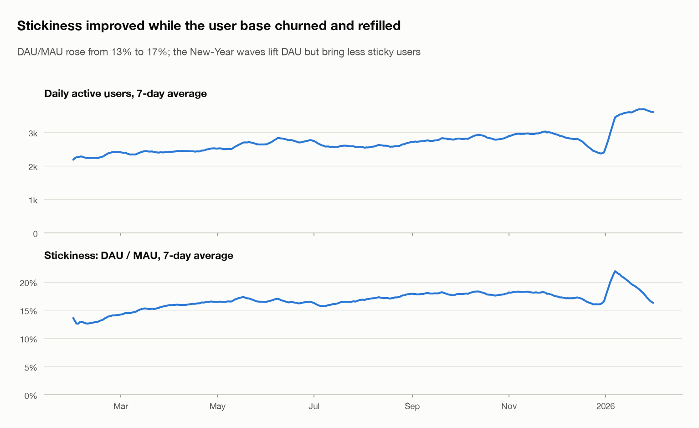

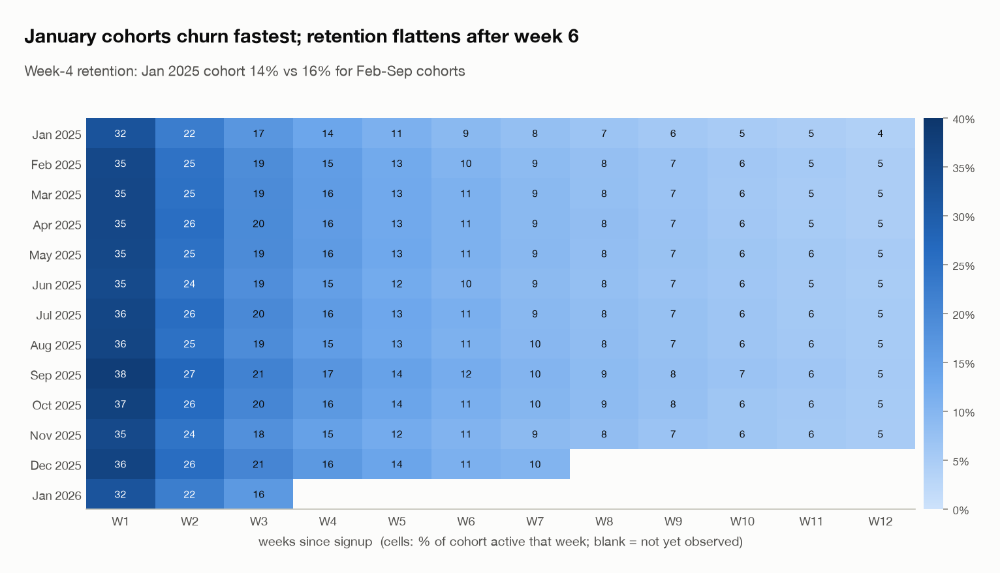

Retention drops fast in the first three weeks and then flattens. Cohorts that sign up in
early January (New Year resolutions) retain worst. Referral and organic users retain
about twice as well as users from influencer campaigns.

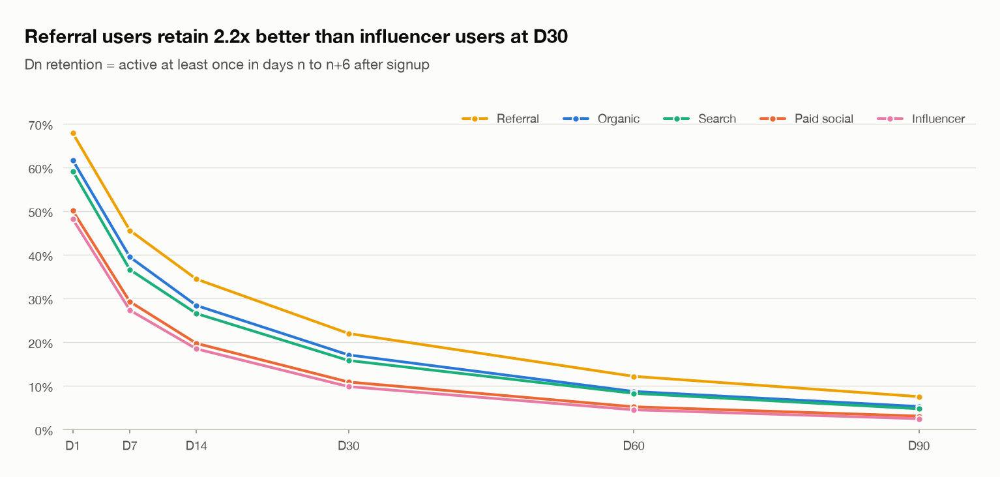

## Funnel and activation

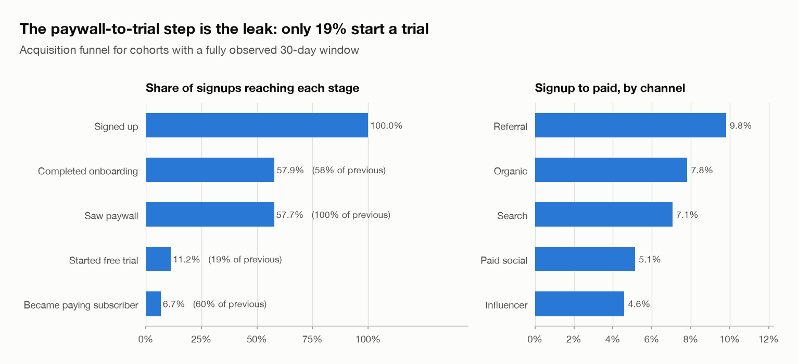

The biggest leak is between the paywall and the trial. Once people start a trial, most of
them pay.

To look for an activation point I tested simple rules like "at least k active days in
week one" and "at least k workouts in week one", and picked the rule that best separates
users who are still active at D30 (Youden's J). Coming back on 3 of the first 7 days was
the best rule. About 37% of new users reach it. This is a correlation, so the next step
would be an experiment that pushes users towards that third visit.

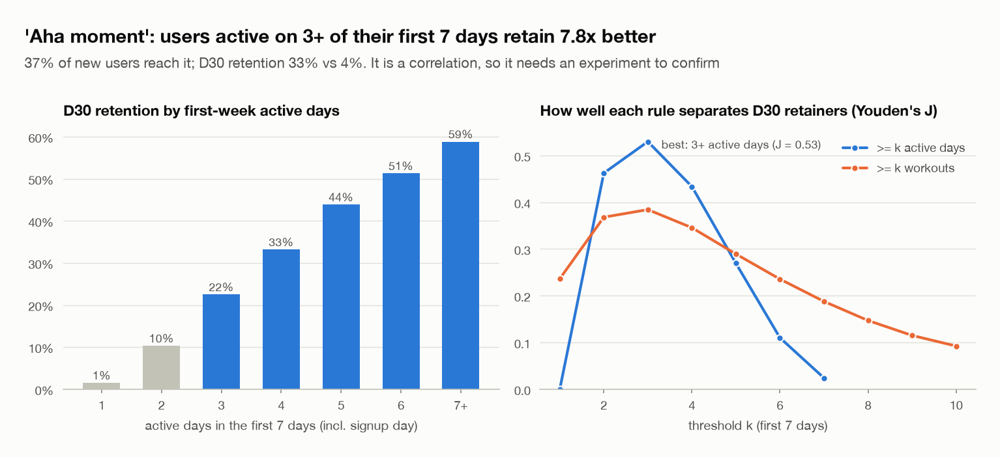

## Experiment 1: onboarding v2

New users were split 50/50 between the old 5-step onboarding and a new 3-step flow. The
plan, written before the analysis, is in
[docs/experiment_preregistration.md](docs/experiment_preregistration.md): D7 retention
as the primary metric, 5,908 users per arm for a 2.5 pp effect, 6 weeks.

The sample ratio check failed on web. Only 32% of logged web users were in treatment.

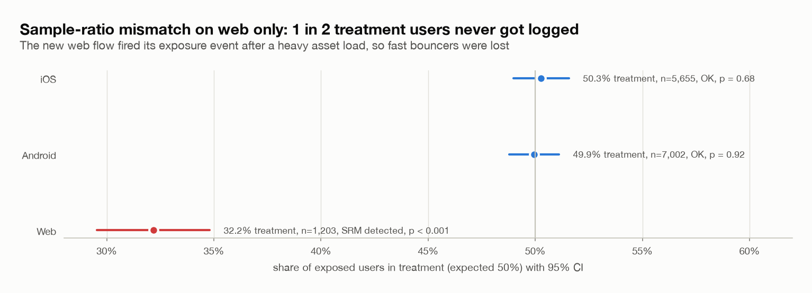

The new web flow sent its exposure event after a large asset bundle loaded, so users who
left quickly were never logged. The web treatment group was left with the more engaged
users, and the web-only comparison shows +11.8 pp when the true effect is +1.7 pp. I
excluded web and analysed iOS and Android, where the split was fine.

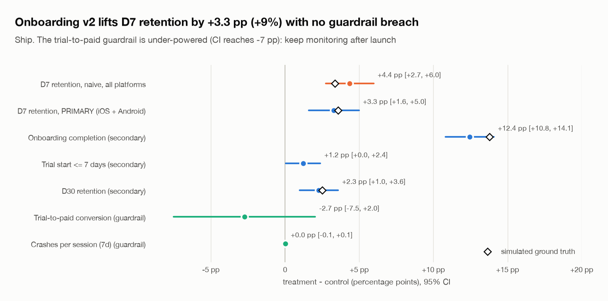

- D7 retention: +3.3 pp (+8.8% relative), p < 0.001.
- Onboarding completion +12.4 pp, D30 retention +2.3 pp, trial starts +1.2 pp (Holm-adjusted).
- Guardrails: no significant harm. The trial-to-paid CI still reaches -7.5 pp, so that
  one needs monitoring after launch. (The simulator does have a small negative effect
  there, which this sample was too small to detect.)

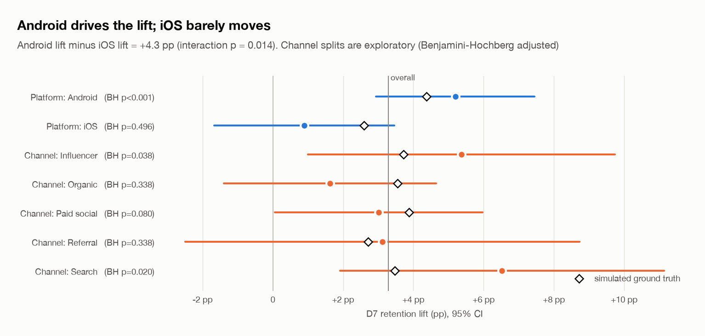

The lift is mostly on Android (+5.2 pp vs +0.9 pp on iOS, interaction p = 0.014).

Decision: ship on iOS and Android, fix the web logging and re-test web.

## Experiment 2: smart reminders

Existing active users were split 50/50 for 28 days. The metric is completed workouts per
user, which is heavy-tailed: half the users did none and the top 10% did 47% of all
workouts.

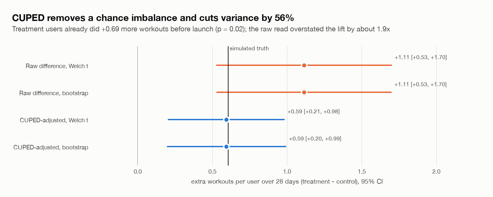

By chance, the treatment group was already more active before launch (+0.69 workouts,
p = 0.02). The raw difference mixes that head start with the real effect. CUPED uses
each user's pre-launch workouts as a covariate, which removes the imbalance and cuts the
variance by 56%. The bootstrap CI agrees with the t-test CI.

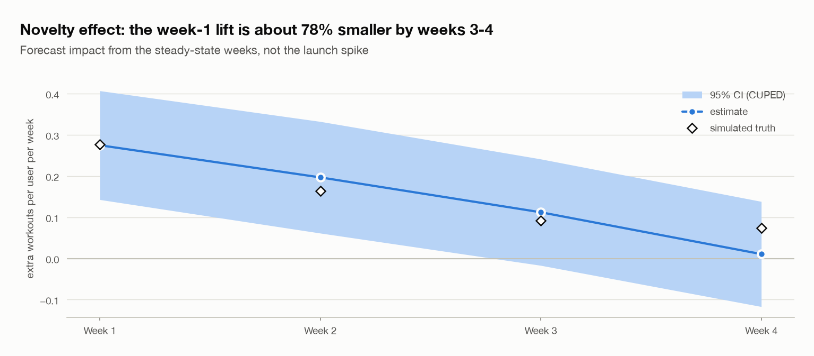

Most of the effect is in the first week. By weeks 3-4 it is small and not significant,
so I would forecast impact from the later weeks, not the 28-day average.

## Churn model and retention offer

I score each monthly subscriber on day 14 and predict whether they will switch off
auto-renew before the first renewal. Features use only the first 14 days (to avoid
leakage), and the model is trained on subscriptions that started before September and
tested on later ones.

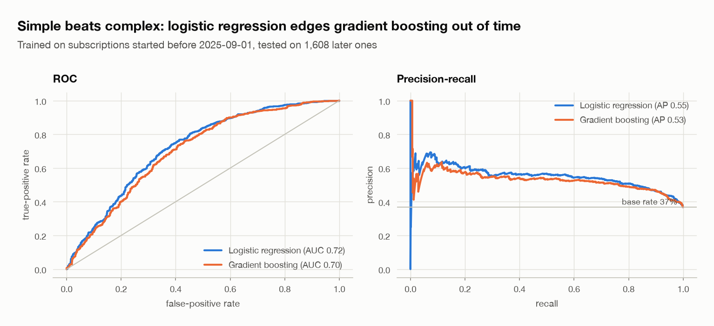

Logistic regression (test ROC-AUC 0.722) did slightly better than gradient boosting
(0.703). The riskiest decile churns at 1.7x the base rate and the riskiest 30% contain
46% of churners. Active days and week-2 workouts matter most.

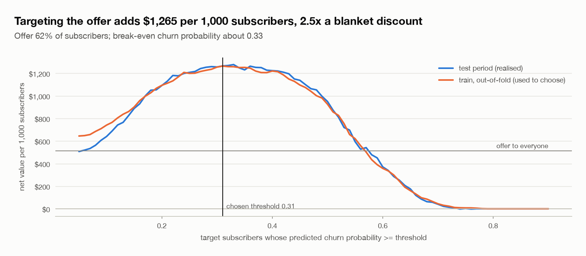

A model is only useful if it changes a decision, so I priced a retention offer (50% off
the next month). The threshold is chosen on training data. On the test period, targeting
the 62% of subscribers above it is worth $1,265 per 1,000 subscribers, 2.5x more than
giving everyone the discount.

## Marketing efficiency

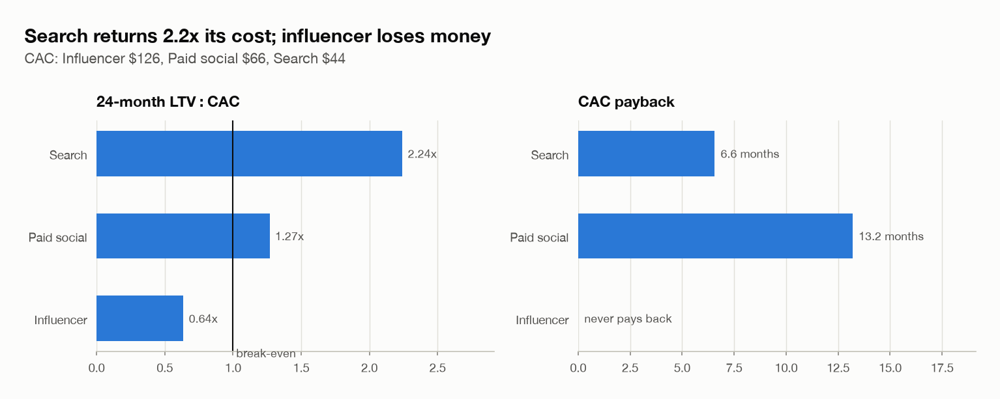

Search costs $44 per paying subscriber and pays back in 6.6 months. Influencer costs $126
and never pays back. I fitted spend-response curves per channel with month and weekday
fixed effects, because budgets go up in January when demand is high anyway. All three
channels show diminishing returns (elasticities 0.76 to 0.86, close to the planted
values).

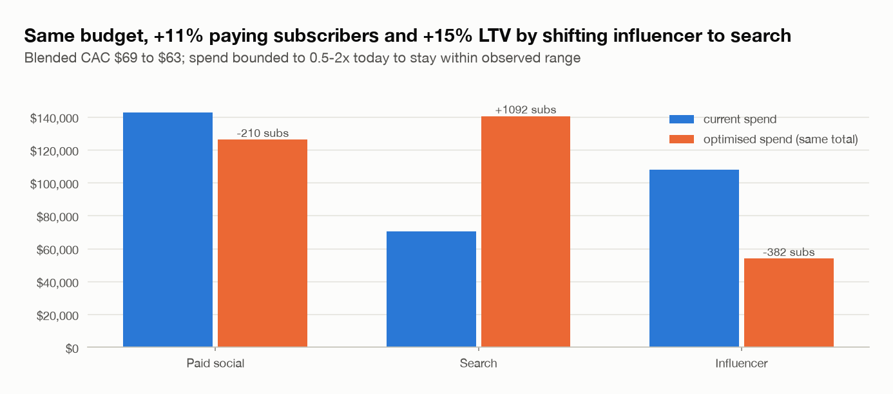

Keeping the total budget fixed and each channel within 0.5x to 2x of its current spend,
moving money from influencer to search gives about 500 more paying subscribers (+11%)
and lowers blended CAC from $69 to $63.

## Did the methods work?

One simulated dataset is a single draw, so I re-ran the whole pipeline with 40 new seeds.
The 95% CIs covered the true effect 95% of the time for the onboarding test and 90% for
the reminders test. The SRM check caught the web bug in all 40 runs with no false alarms
on iOS or Android.

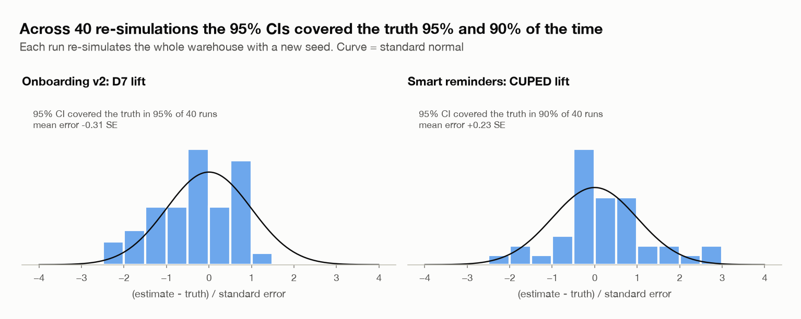

All 20 figures are in [reports/figures](reports/figures), the tables behind them are in
[reports/tables](reports/tables), and a one-page summary is in
[reports/executive_summary.md](reports/executive_summary.md). The notebook
[notebooks/01_growth_analysis_walkthrough.ipynb](notebooks/01_growth_analysis_walkthrough.ipynb)
goes through everything step by step.

## How it is built

1. `simulate.py` writes raw parquet tables to `data/raw/` and the true effects to `data/ground_truth.json`.
2. `warehouse.py` runs `sql/01` to `sql/07` in DuckDB: staging views, a user-day fact table, a user dimension and marts.
3. `pipeline.py` runs the analyses and writes figures, CSV tables and `reports/metrics.json`.
4. `dashboard/app.py` is a Streamlit dashboard on top of the warehouse.

```
.
├── sql/                     DuckDB models (staging, facts, marts)
├── src/growth_analytics/
│   ├── simulate.py          data generator with planted effects
│   ├── warehouse.py         runs the SQL files
│   ├── funnel.py            funnel and activation analysis
│   ├── stats.py             power, SRM, z-test, Welch, CUPED, bootstrap, delta method, Holm, BH
│   ├── experiments.py       read-outs for both experiments
│   ├── churn_model.py       day-14 churn model and offer policy
│   ├── marketing.py         response curves and budget optimiser
│   ├── figures.py           all charts (plotting.py has the style)
│   ├── validation.py        multi-seed coverage study
│   └── pipeline.py          runs everything
├── dashboard/app.py         Streamlit dashboard
├── notebooks/               walkthrough notebook (built by build_notebook.py)
├── reports/                 figures, tables, metrics.json, executive summary
├── docs/                    data dictionary, metric definitions, methodology, experiment plans
└── tests/                   pytest
```

## How to run

Python 3.11 or newer.

```bash
python -m venv .venv && source .venv/bin/activate
pip install -e ".[dev]"

make data        # simulate the raw data (a few seconds)
make warehouse   # build data/warehouse.duckdb
make analysis    # figures, tables and reports/metrics.json
make test        # pytest
make dashboard   # streamlit dashboard
make notebook    # rebuild and execute the notebook
```

`python -m growth_analytics.validation --seeds 40` re-runs the coverage study (about 4
minutes).

## Tools

Python (pandas, NumPy, SciPy, statsmodels, scikit-learn), DuckDB SQL, matplotlib,
Plotly, Streamlit, pytest, Jupyter.

## Limitations and next steps

- The data is simulated. Real tracking is messier and has effects I did not model.
- LTV assumes a constant churn rate and is capped at 24 months.
- The activation rule and churn drivers are correlations. The obvious next experiment is
  a nudge towards a third active day in week one.
- The trial-to-paid guardrail needs a larger sample or a holdout after launch.
- Spend elasticities are only reliable near the observed spend levels.
